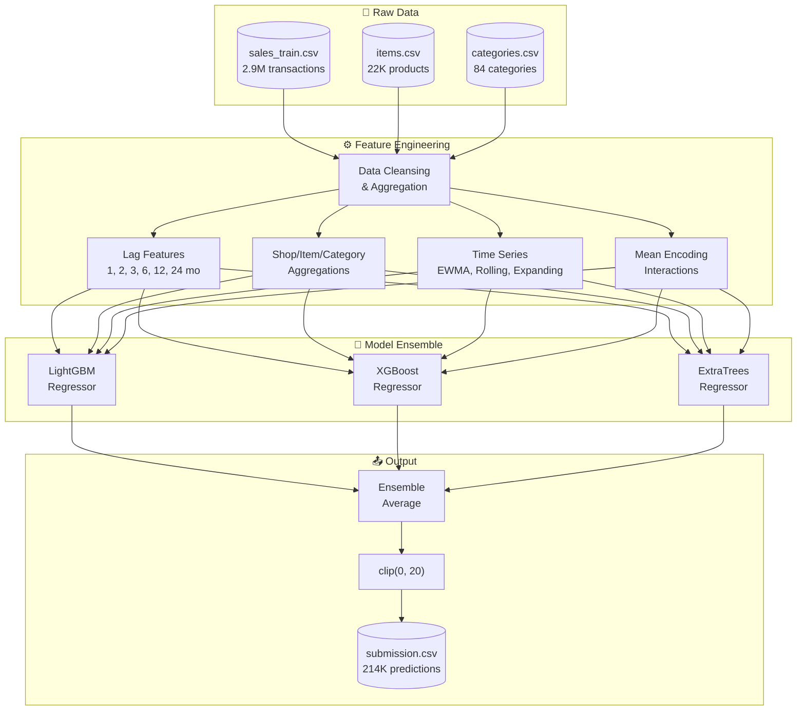
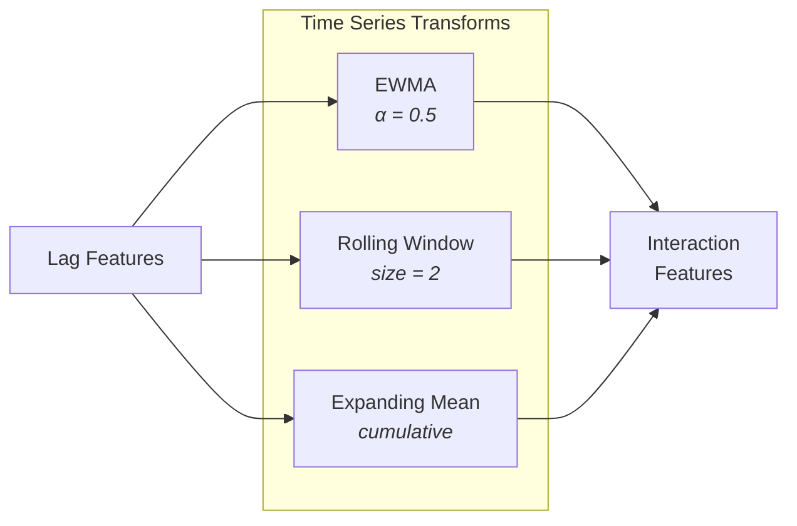
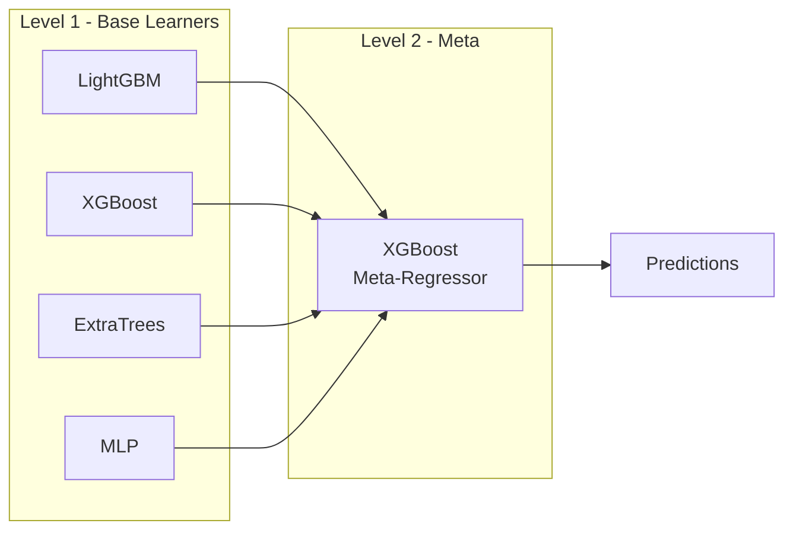
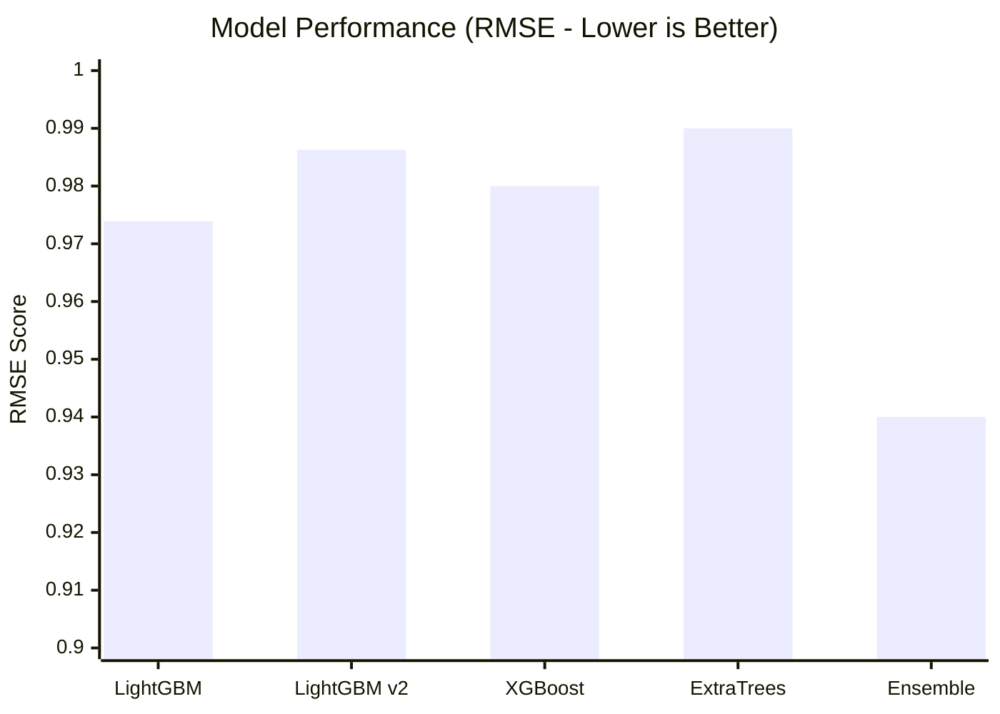
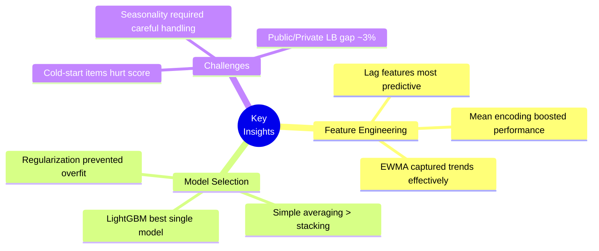

<div align="center">

# 🏆 1C Future Sales Prediction

### A Top-15 Kaggle Solution Using Ensemble Gradient Boosting

[](https://www.kaggle.com/c/competitive-data-science-final-project)
[](https://www.kaggle.com/c/competitive-data-science-final-project/leaderboard)
[](https://python.org)
[](LICENSE)

**Predicting monthly item sales across 60 shops and 22,000+ products using 40+ engineered features and stacked gradient boosting models.**

[Competition](#-competition) • [Architecture](#%EF%B8%8F-solution-architecture) • [Features](#-feature-engineering) • [Models](#-models) • [Results](#-results) • [Usage](#-getting-started)

</div>

---

## 🎯 Competition

The **["Predict Future Sales"](https://www.kaggle.com/c/competitive-data-science-final-project)** challenge (December 2017) tasked competitors with forecasting total sales for every product-shop pair for the following month across 1C Company's retail network.

| Metric | Value |
|--------|-------|
| **Task** | Time-series regression |
| **Target** | Monthly item sales (clipped 0-20) |
| **Training Period** | Jan 2013 – Oct 2015 (34 months) |
| **Test Period** | November 2015 |
| **Shops** | 60 retail locations |
| **Products** | 22,170 unique items |
| **Categories** | 84 item categories |
| **Training Samples** | ~2.9M transactions |

### The Challenge

Unlike typical regression problems, this competition presented several unique difficulties:

- **Cold-start problem**: 363 items in the test set never appeared in training
- **Sparse combinations**: 16,102 shop-item pairs in test had no training history
- **Temporal patterns**: Strong seasonality and year-over-year trends
- **Russian text**: Shop and category names required translation for feature extraction

---

## 🏗️ Solution Architecture



### File Structure

| File | Purpose |
|------|---------|
| `submission.py` | Entry point - orchestrates full pipeline |
| `contest.py` | Feature engineering class (40+ derived features) |
| `build.py` | Model builders with tuned hyperparameters |
| `*.ipynb` | EDA and validation analysis notebooks |

---

## 🔬 Feature Engineering

The feature engineering pipeline generates **40+ derived features** from raw transaction data. This was the primary driver of model performance.

### Lag Features

Parallel period shifts capturing historical sales patterns:

| Feature Pattern | Periods | Description |
|-----------------|---------|-------------|
| `pps_item_cnt_month_lag_{n}` | 1, 2, 3, 6, 12 | Item sales at shop N months ago |
| `pps_item_cnt_month_shoponly_lag_{n}` | 1, 2, 3, 6, 12 | Total shop sales N months ago |
| `pps_item_cnt_month_itemonly_lag_{n}` | 1, 2, 3, 6, 12 | Total item sales (all shops) N months ago |
| `pps_item_category_cnt_month_lag_{n}` | 1, 2, 3, 6, 12 | Category sales at shop N months ago |
| `pps_super_category_cnt_month_lag_{n}` | 1, 2, 3, 6, 12 | Super-category sales N months ago |

### Encoded Features

Mean-encoded aggregations to capture categorical interactions:

| Feature Pattern | Grouping | Description |
|-----------------|----------|-------------|
| `MEAN_pps_item_cnt_month_lag_{n}` | shop × item | Mean-encoded lagged sales |
| `MEAN_pps_item_cnt_month_shoponly_lag_{n}` | shop | Shop-level mean encoding |
| `MEAN_pps_item_cnt_month_itemonly_lag_{n}` | item | Item-level mean encoding |

### Time Series Features



| Feature | Formula | Purpose |
|---------|---------|---------|
| `ewma_pps_item_cnt_month_lag_1_by_shop_id_item_id` | EWMA(lag₁, α=0.5) | Smoothed trend |
| `rw2_pps_item_cnt_month_lag_1_by_shop_id_item_id` | rolling_mean(lag₁, w=2) | Short-term average |
| `exp_mean_pps_item_cnt_month_lag_1_by_shop_id_item_id` | expanding_mean(lag₁) | Long-term baseline |

### Interaction Features

Derived features capturing relationships between base features:

| Feature | Operation | Captures |
|---------|-----------|----------|
| `INTERACT__MEAN_pps_*_lag_1__*_lag_12_DIFF` | lag₁ − lag₁₂ | Year-over-year trend |
| `INTERACT__MEAN_pps_*_lag_1__*_lag_6_DIFF` | lag₁ − lag₆ | Half-year momentum |
| `INTERACT__pps_*__pps_*_shoponly_DIV` | item_sales / shop_sales | Item share of shop |
| `INTERACT__pps_*__exp_mean_*_DIV` | current / expanding_mean | Deviation from baseline |
| `AAAAA_ravg_prior2` | (lag₁ + lag₂) / 2 | 2-month rolling average |
| `AAAAA_ravg_prior3` | (lag₁ + lag₂ + lag₃) / 3 | 3-month rolling average |

---

## 🤖 Models

### Primary Model: LightGBM

The best single-model performance came from LightGBM with carefully tuned hyperparameters:

```python
lgbmParams = {
    'n_estimators': 50,
    'learning_rate': 0.4,
    'max_depth': 10,
    'num_leaves': 70,
    'max_bin': 255,
    'subsample_for_bin': 50000,
    'subsample': 1.0,
    'colsample_bytree': 1.0,
    'reg_lambda': 0.0001,
    'reg_alpha': 0.0,
    'min_child_weight': 1e-3,
    'min_child_samples': 20,
    'random_state': 736283,
    'n_jobs': -1
}
```

### Ensemble Components

The final submission used a bagged average of three models:

| Model | Library | Key Parameters | Strength |
|-------|---------|----------------|----------|
| **LGBMRegressor** | LightGBM | depth=10, leaves=70, lr=0.4 | Speed, categorical handling |
| **XGBRegressor** | XGBoost | depth=7, lr=0.5, n_est=75 | Regularization, accuracy |
| **ExtraTreesRegressor** | scikit-learn | depth=13, n_est=50 | Variance reduction |

### Alternative: Stacked Models

Two stacking approaches were explored but didn't improve scores:



| Approach | Meta-Learner | CV Folds | Result |
|----------|--------------|----------|--------|
| `StackingRegressor` | XGBoost | None | No improvement |
| `StackingCVRegressor` | ElasticNet | 5 | No improvement |

> **Finding**: Simple averaging outperformed stacking, likely due to the high correlation between base model predictions.

---

## 📊 Results

### Leaderboard Performance

| Metric | Score |
|--------|-------|
| **Private Leaderboard** | **0.94x** |
| **Public Leaderboard** | 0.97x |
| **Final Rank** | **13th** (at CY 2017 close) |
| **Evaluation Metric** | RMSE (Root Mean Squared Error) |

### Model Comparison



| Model | Public LB | Private LB | Notes |
|-------|-----------|------------|-------|
| LightGBM (tuned) | 0.9740 | 0.9739 | Best single model |
| LightGBM (alt) | 0.9863 | 0.9841 | Higher regularization |
| XGBoost | ~0.98 | ~0.98 | Standalone |
| ExtraTrees | ~0.99 | ~0.99 | Standalone |
| **Ensemble (avg)** | **~0.97** | **~0.94** | Final submission |

### Key Insights



### What Worked

✅ **Extensive lag features** - 1, 2, 3, 6, 12 month parallels captured seasonality
✅ **Mean encoding** - Shop×Item interactions without explosion of dimensionality
✅ **EWMA smoothing** - Reduced noise while preserving trend signals
✅ **Simple ensemble** - Averaging 3 diverse models reduced variance
✅ **Target clipping** - Enforcing [0, 20] bounds matched evaluation criteria

### What Didn't Work

❌ **Stacking** - Added complexity without improving scores
❌ **Deep trees** - Overfitting on sparse shop-item combinations
❌ **Price features** - Removed in final model (added noise)
❌ **Neural networks (MLP)** - Underperformed gradient boosting

---

## 🚀 Getting Started

### Prerequisites

- Python 3.6+
- 8GB+ RAM recommended (feature engineering is memory-intensive)

### Installation

```bash
# Clone the repository
git clone https://github.com/cbenge509/1C_Regression.git
cd 1C_Regression

# Install dependencies
pip install pandas numpy scikit-learn xgboost lightgbm mlxtend
```

### Data Setup

Download the competition data from [Kaggle](https://www.kaggle.com/c/competitive-data-science-final-project/data) and update the paths in `submission.py`:

```python
# Update these paths to your local data directory
trainDataFile = '/path/to/your/data/sales_train.csv'
testDataFile = '/path/to/your/data/test.csv'
itemDataFile = '/path/to/your/data/items.csv'
categoryDataFile = '/path/to/your/data/item_categories.csv'
```

### Running the Pipeline

```bash
# Full pipeline: feature engineering → training → prediction
python submission.py
```

### Pipeline Output

| File | Description |
|------|-------------|
| `pp_data_sales_train.csv` | Engineered training features |
| `pp_labels_sales_train.csv` | Training labels |
| `pp_test.csv` | Engineered test features |
| `submission.csv` | Final predictions for Kaggle |

---

## 📦 Dependencies

| Package | Purpose |
|---------|---------|
| `pandas` | Data manipulation and aggregation |
| `numpy` | Numerical operations |
| `scikit-learn` | ExtraTreesRegressor, preprocessing, pipelines |
| `lightgbm` | LGBMRegressor (primary model) |
| `xgboost` | XGBRegressor (ensemble component) |
| `mlxtend` | StackingRegressor, StackingCVRegressor |

---

## 📓 Notebooks

Detailed analysis available in the Jupyter notebooks:

| Notebook | Description |
|----------|-------------|
| `Initial EDA.ipynb` | First-pass exploration of sales patterns |
| `Second EDA.ipynb` | Deep dive into shop and item distributions |
| `Third EDA.ipynb` | Category analysis and seasonality |
| `Validation Analysis.ipynb` | Train/validation split analysis, correlation studies |

---

## 👤 Author

**Cristopher Benge**
[](https://github.com/cbenge509)

---

## 📄 License

This project is licensed under the MIT License - see the [LICENSE](LICENSE) file for details.

---

<div align="center">

**⭐ If this solution helped you, consider giving it a star! ⭐**

*Built with ☕ and gradient boosting — December 2017*

</div>
